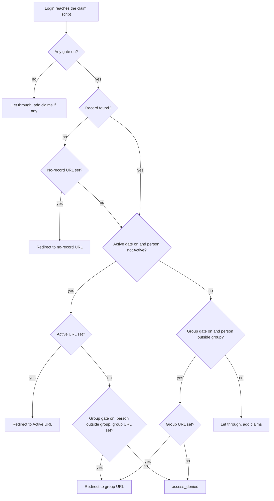
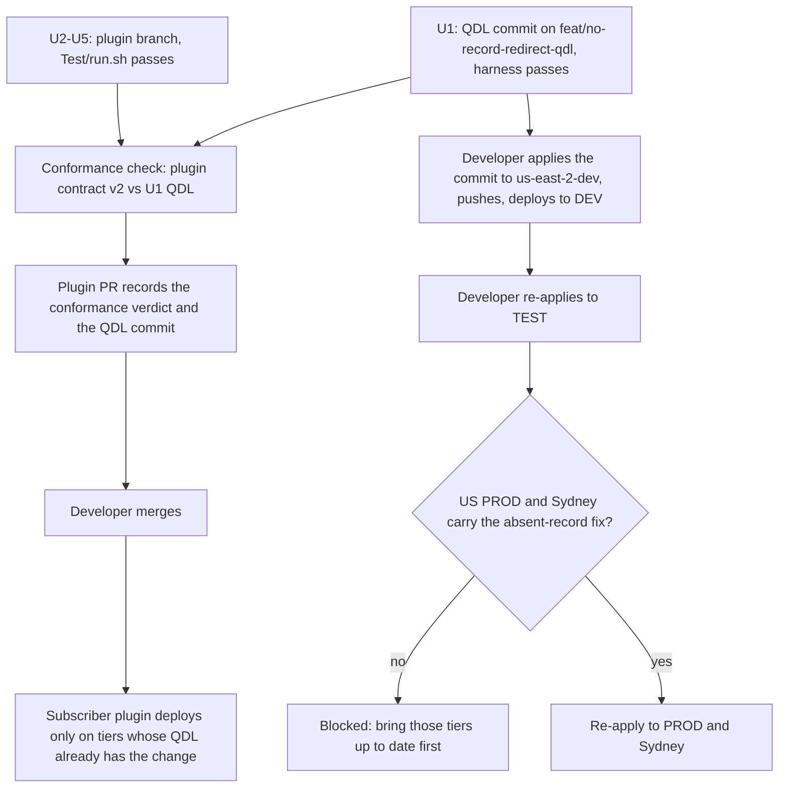

# No Record Redirect for Gated OIDC Clients - Plan

## Goal Capsule

- **Objective:** When a gated OIDC client refuses a person, that person lands on a page meant for their situation: people the CO holds no record for (never enrolled, still pending, refused, or logging in with an unlinked identity) go to a destination the admin chooses, such as an enrollment flow, and registered people go to the gate URL that fits them.
- **Means:** A QDL change on the `us-east-2-dev` tier branch that adds the no-record branch and the status-first gate order (KTD3), then a plugin change that stores, sends, reads back, and sync-checks the new URL (KTD1, KTD4).
- **Product authority:** The developer. The Product Contract wins on product behavior; KTDs win on mechanism. Bringing the Sydney (`cilogon-service-config-au`) and US PROD QDL up to date is a dependency, not active scope.
- **Execution profile:** Two repositories. U1 is a local commit on a new branch cut from `us-east-2-dev` (`feat/no-record-redirect-qdl`) in a worktree of `cilogon-service-config-us`, never pushed. U2-U5 are one branch and one pull request in this repo.
- **Stop conditions:** Stop and report if any existing case in the QDL gate harness has to change to pass, which would mean behavior moved outside R8; if `bin/qdl-conformance.php` reports FAIL against the U1 commit; or if an existing client reads out of sync after the plugin change.
- **Finishing:** `ce-work` implements and verifies with the QDL harness, the conformance check, and `Test/run.sh`. The developer pushes the QDL commit, promotes it through the tiers, runs the live tier, and merges the plugin PR.
- **Open blockers:** None for planning. Promoting to US PROD and Sydney is blocked until each of those tiers carries the absent-record gate fix (Dependencies / Assumptions).

---

## Product Contract

### Summary

A client's Authorization settings gain a third redirect URL, "no record," used for a person the CO's DynamoDB table holds no record for, when at least one gate is on. The help text and manual say exactly who that is. The QDL checks Active status before group membership, falling back to the group URL so every redirect an admin has already configured keeps working. The QDL change ships first and is additive; the plugin then adds the field.

### Problem Frame

The DynamoDB claim script (`dynamodb_claims.qdl`) has two authorization gates, group membership and Active status, each with an optional redirect URL used when the gate refuses someone. Three different kinds of people fail those gates: people with no record, registered people whose status is not Active (Suspended, Expired, GracePeriod), and Active people outside the authorization group.

"No record" is broader than "never enrolled." The DynamoDB provisioner stores nothing for people who are Pending, PendingApproval, PendingConfirmation, PendingVetting, Invited, Confirmed, Denied, Declined, Duplicate, or Deleted. The table is keyed on the login's identity, so a member logging in with an identity not linked to their CO Person record also has no record.

An admin who wants people without a record to land on an enrollment flow, or on a page explaining how to get access, cannot do it today:

- The group gate runs first, so when both gates are on it catches nearly everyone, and the Active redirect is almost never reached. Since Require Active Status became the default for new confidential clients (cilogon/Oa4mpClient#31), clients with both gates on will be common.
- Each gate has one URL, so it cannot tell its populations apart. An enrollment URL on the Active gate also catches suspended and expired members, who need an admin rather than a second enrollment. An enrollment URL on the group gate catches Active members who simply lack the group.

### Key Decisions

- **Separate outcome for people with no record, rather than per-status URLs or reordering alone.** It separates the people the gates cannot otherwise tell apart, with one new setting. Governs R1, R2. (session-settled: user-approved -- chosen over per-status destinations and over reordering the gates only: per-status URLs add the most configuration to the plugin and the QDL contract, and reordering alone still sends never-registered and inactive people to one URL)
- **Name the outcome for what the script can see, and document who reaches it.** The script cannot tell a never-enrolled person from a pending, refused, or unlinked one, so the setting is called "no record" and the guidance lists everyone it catches; admins choose a destination that is safe for all of them. Governs R1, R12, R13. (session-settled: user-directed -- chosen over changing the DynamoDB provisioner to store a status-only record for pending and refused people, and over dropping the new outcome: no new provisioner dependency, and admins still get the redirect)
- **The no-record URL applies only when a gate is on.** A client with no gate stays a plain claim source, and setting a URL does not quietly create a "must be registered" gate. Governs R3. (session-settled: user-approved -- chosen over making the URL itself a registration requirement)
- **Status is checked before group membership.** Status is the actual blocker for an inactive person, who cannot usefully join a group until Active. Governs R5. (session-settled: user-approved -- chosen over keeping group first)
- **Backward compatibility through a fallback to the group URL.** One QDL per tier serves every subscriber and plugin version, so the reorder must keep every configured redirect working; R8 names the cases where a destination moves. Governs R6, R8. (session-settled: user-approved -- chosen over enabling the new order only when the new key is present, applying the reorder to everyone, or dropping it: the fallback keeps every existing redirect working without tying the order to an unrelated setting)
- **Returning to the original login after enrollment is out of scope.** The redirect is a fixed URL carrying nothing about the login in progress; admins set a return URL in the enrollment flow itself. (session-settled: user-approved -- chosen over researching a return path through OA4MP and COmanage's return-URL allow-list)

### Requirements

**No-record outcome**

- R1. A confidential OIDC client's authorization settings carry an optional "no record" redirect URL, alongside the existing group and Active redirect URLs.
- R2. When at least one gate is on and the person has no record, they are redirected to the no-record URL if it is set, before either gate is evaluated.
- R3. When no gate is on, the no-record URL has no effect: a person with no record is let through with no added claims, as today.
- R4. When the no-record URL is not set, a person with no record is refused by the gates per R5-R7, never let through.

**Gate order and destinations**

- R5. A registered person whose status is not Active is refused by the Active gate whether or not they are in the authorization group; with an Active URL set, they go there.
- R6. When the Active gate refuses and no Active URL is set, a person goes to the group URL only if the group gate is on, they are outside the group, and a group URL is set; otherwise they receive `access_denied`.
- R7. An Active person outside the authorization group goes to the group URL if set, otherwise receives `access_denied`, as today.

**Compatibility and rollout**

- R8. For a cfg without the no-record URL, every person reaches the same destination as today, except on a client with both gates on and the Active URL set: a person who is neither Active nor in the group, including a person with no record, now goes to the Active URL instead of the group URL, or instead of `access_denied` when no group URL is set.
- R9. The QDL change is additive: it declares and implements the new cfg key, and is deployed to a tier before any plugin release that sends that key.
- R10. The plugin saves, sends, reads back, and sync-checks the no-record URL the same way it does the other two redirect URLs.
- R11. Public clients cannot carry the setting, as with every other authorization setting, since OA4MP accepts no custom cfg on them.

**Admin guidance**

- R12. The field's help text says the URL applies only when a gate is on, and that it reaches everyone without a record: people never enrolled, people who are invited or whose enrollment is pending, confirmed, or unconfirmed, people whose petition was denied or declined, people marked duplicate or deleted, and members logging in with an identity not linked to their CO Person record.
- R13. The user manual (`docs/oidc-client-plugin-manual.md`) describes the three redirects and which people each one reaches, and advises pointing the no-record URL at a page that is safe for every group in R12, such as an explanation of how to get access or an enrollment flow that checks for an existing CO Person.

### Gate decision

A person with no record who falls through from the no-record branch reaches the Active check with no status and is treated as not Active. If only the group gate is on, they fail the group check instead.

### Acceptance Examples

- AE1. **Covers R2.** Given both gates on and all three URLs set, when a person who never enrolled logs in, they are redirected to the no-record URL.
- AE2. **Covers R3.** Given no gate on and a no-record URL set, when a person with no record logs in, they are let through with no added claims.
- AE3. **Covers R4, R6.** Given both gates on, only the group URL set, when a person with no record logs in, they go to the group URL, as today.
- AE4. **Covers R2.** Given only the group gate on and a no-record URL set, when a person with no record logs in, they go to the no-record URL.
- AE5. **Covers R5.** Given both gates on, Active and group URLs set, when a Suspended person who is in the group logs in, they go to the Active URL, as today.
- AE6. **Covers R5, R8.** Given both gates on, Active and group URLs set, when a Suspended person outside the group logs in, they go to the Active URL (today: the group URL).
- AE7. **Covers R6, R8.** Given both gates on, only the group URL set, when a Suspended person outside the group logs in, they go to the group URL, as today.
- AE8. **Covers R6.** Given both gates on, only the group URL set, when a Suspended person inside the group logs in, they receive `access_denied`, as today.
- AE9. **Covers R7.** Given both gates on, Active and group URLs set, when an Active person outside the group logs in, they go to the group URL.
- AE10. **Covers R2, R12.** Given both gates on and a no-record URL set, when a member logs in through an identity provider not linked to their CO Person record, they go to the no-record URL.
- AE11. **Covers R5, R8.** Given both gates on and only the Active URL set, when an Expired person outside the group logs in, they go to the Active URL (today: `access_denied`).
- AE12. **Covers R2, R12.** Given both gates on and a no-record URL set, when a person whose petition is PendingApproval, or whose petition was Denied, logs in, they go to the no-record URL.

### Scope Boundaries

- Separate destinations per CO Person status (Pending, Suspended, Expired, and so on).
- Changing the DynamoDB provisioner to store a record for pending or refused people, so that "no record" would mean "never enrolled."
- Sending the person back into the original login after enrollment.
- Hiding or validating the field based on whether a gate is on; R12's help text is the only guidance.
- Changes to the LDAP claim scripts, which carry no authorization gates.
- Bringing the Sydney QDL copy up to date (see Dependencies / Assumptions).

### Dependencies / Assumptions

- **US PROD QDL is behind.** `origin/us-east-2-prod` (fetched 2026-10-12; `dynamodb_claims.qdl` last changed 2026-07-17) still returns before any gate when there is no record, so on that tier a person with no record passes both gates. It also lacks the cfg-key declarations, the gate markers, and the gate test. Promotion to PROD needs the earlier contract-declaration and absent-record commits from `us-east-2-dev` as well as this feature's.
- **Sydney QDL is behind.** The local `cilogon-service-config-au` checkout (branch `ap-southeast-2-prod`) lacks the absent-record fix: its script returns before any gate when there is no record, so a never-registered person passes both gates on that tier. It also lacks the `has_key` guard on `cm_status`, the cfg-key declarations, and the gate tests. This was seen in a local checkout that may be stale. If it holds, the Sydney copy needs that fix, a security issue in its own right, before this feature can deploy there.
- **Who has no record (verified).** The DynamoDB provisioner writes no record for Pending, PendingApproval, PendingConfirmation, PendingVetting, Invited, Confirmed, Denied, Declined, Duplicate, or Deleted people, and deletes an existing record when a person moves into one of those statuses or loses the identifier the partition key is built from (`syncPerson` in the DynamoProvisioner plugin's `Model/CoDynamoProvisionerTarget.php`). Suspended, Expired, and GracePeriod records are kept with their status. The partition key is built from the login's `sub` claim, so a member logging in with an unlinked identity also has no record.
- **Deployment order follows the QDL topology rule:** the QDL goes to each tier (us DEV, TEST, PROD; au) before any subscriber's plugin release that sends the new key (R9). The QDL repos are canonical `cilogon` repos, so changes there are proposed, not pushed.

### Sources / Research

- `dynamodb_claims.qdl` in `cilogon-service-config-us` on `us-east-2-dev`, at `roles/oa4mp-server/files/qdl/COmanageRegistry/default/`: the gate region between the `BEGIN authorization gates` and `END authorization gates` markers (lines 138-267).
- `roles/oa4mp-server/tests/qdl/test_authorization_gates.qdl` in the same repo: extracts the gate region and runs cases against it; the acceptance examples above are its natural new cases.
- `Model/CoDynamoProvisionerTarget.php` in the DynamoProvisioner plugin (lines 609-629): the statuses for which no record is stored.
- `Model/Oa4mpClientAuthorization.php`, `Model/Oa4mpClientOa4mpServer.php` (marshalling, unmarshalling, and the sync check for the existing redirect URLs), `cfg_contract.json`, and `Lib/lang.php` (existing redirect-URL help text).
- `docs/plans/2026-08-23-0844-feat-cfg-qdl-contract-plan.md`: the cfg/QDL contract that the new key must join.
- `docs/plans/2026-09-28-1104-feat-require-active-status-default-plan.md`: the Require Active Status default that makes both gates common.

**Product Contract preservation:** changed: Dependencies / Assumptions -- added the US PROD QDL finding from planning research; Outstanding Questions resolved by KTD1 and KTD4 and removed. Requirements, Key Decisions, and acceptance examples unchanged.

---

## Planning Contract

### Key Technical Decisions

- KTD1. **The column and the cfg key are both `no_record_redirect_url`.** This follows `require_active_redirect_url`, which uses one name on both sides; the group URL's two names (`authz_group_redirect_url` / `authorization_group_redirect_url`) are the exception, not the pattern.
- KTD2. **"Set" means present and non-empty, for all three URLs.** The QDL tests each URL with `size(...) > 0`, as it does today, and the plugin emits a URL only when `!empty()`. An empty string never produces a redirect to an empty URI. Governs the reading of R2, R4, R6.
- KTD3. **The QDL gate region gets one variable per URL, computes group membership once and only when the group gate is on, and adds the no-record branch after the existing early return and before the Active gate.** The current gates share one `redirect_url` variable, which the fallback would read wrongly. Reading `authorization_group_id` without the group gate on is an interpreter error. The region still reads only `config_params.` and `item.` and calls only `log_line` and `raise_error`, so the harness extraction keeps working. Implements R2-R7 (see the Gate decision diagram in the Product Contract).
- KTD4. **`cfg_contract.json` advances to `contract_version: 2` with the new arg `introduced_in: 2`.** The contract's version policy requires a bump when the declared set changes, and `ContractDeclarationTest` rejects an `introduced_in` above the version. The sync check never reads the version stamp, so existing clients are not flagged.
- KTD5. **The comparator reads the plugin side of the new column with `?? null`.** A row loaded before `cake database` adds the column, and the live tier's stand-in row, would otherwise raise undefined-key warnings (`docs/solutions/test-failures/oa4mp-sync-check-needs-the-saved-client-shape.md`). Presence of an authorization row is still decided by its `id`, as today.
- KTD6. **The new field is always visible on the Authorization tab, with no JavaScript toggle.** The existing URL fields hide and clear themselves when their gate is off; the Product Contract's Scope Boundaries rule that out for this field, and R12's help text carries the "only when a gate is on" rule instead.
- KTD7. **The QDL change is prepared as a local commit on `feat/no-record-redirect-qdl`, a branch cut from `us-east-2-dev`, in a new worktree of `cilogon-service-config-us`; it is never pushed.** That repo's only remote is the canonical `cilogon` repo, and this machine has no credentials for it. `us-east-2-dev` is already checked out in the primary checkout, so a worktree cannot use it, and the primary checkout is not touched. The conformance check resolves `--tier` with `git rev-parse`, so naming the feature branch verifies the plugin against the U1 commit; the developer applies that commit to `us-east-2-dev` when pushing.

### High-Level Technical Design

The gate logic is drawn in the Product Contract's Gate decision diagram. The delivery order across the two repositories:

### Assumptions

- The thin test runner can render or source-scan `View/Oa4mpClientAuthorizations/manage.ctp` the way `RequireActivePredicateTest` already does; the UI test in U4 is a source scan, not a rendered page.

---

## Implementation Units

### U1. QDL: no-record branch and status-first gates

**Target repo:** `cilogon-service-config-us`, new branch `feat/no-record-redirect-qdl` cut from `us-east-2-dev`, in a new worktree (KTD7). Paths in this unit are relative to that repo.

**Goal:** The DynamoDB claim script sends a person with no record to the no-record URL when a gate is on, and checks Active status before group membership with the group-URL fallback.

**Requirements:** R2, R3, R4, R5, R6, R7, R8, R9; AE1-AE12. Implements the Key Decisions that govern R2, R3, R5, R6, R8 (session-settled).

**Dependencies:** None.

**Files:**
- `roles/oa4mp-server/files/qdl/COmanageRegistry/default/dynamodb_claims.qdl`
- `roles/oa4mp-server/tests/qdl/test_authorization_gates.qdl`

**Approach:**
1. Add `'no_record_redirect_url'` to `claims_contract_qdl_args.` in the same commit as the code that reads it; the conformance check fails if the code reads an undeclared key.
2. Inside the `BEGIN`/`END authorization gates` region, split the shared `redirect_url` into one variable per URL, each defaulting to `''` (KTD3).
3. Keep the early return for "no record and no gate" unchanged (R3).
4. After it, add the no-record branch: no record and a non-empty no-record URL raises the redirect with its own message (KTD2).
5. Compute "outside the group" once, only when the group gate is on.
6. Run the Active gate first. On refusal it uses the Active URL, else the group URL when the group gate is on and the person is outside the group, else `access_denied` (R5, R6). Log which URL the fallback chose.
7. Run the group gate second for Active people (R7).
8. Keep the region's restriction to `config_params.`, `item.`, `log_line`, and `raise_error`, and update the region's header comment to describe the new order.

**Execution note:** Add the harness cases first and watch the new ones fail against the current region, then change the region. Every existing case must stay green unchanged; if one needs editing, stop (Goal Capsule).

**Patterns to follow:** The existing denial idiom in the gate region (`qdl_error` with `custom_error_uri` when a URL is set, `access_denied` otherwise, status 302). Harness case style: config and item stems with `check` / `check_redirect`.

**Test scenarios:**
- Add a strict helper asserting `error_type == 'access_denied'` and no `custom_error_uri`; `check(..., true)` accepts either kind of denial.
- Covers AE1. Both gates, all three URLs, empty item: redirect to the no-record URL.
- Covers AE2. No gate, no-record URL set, empty item: no error.
- Covers AE3. Both gates, group URL only, empty item: redirect to the group URL.
- Covers AE4. Group gate only, no-record URL set, empty item: redirect to the no-record URL.
- Active gate only, no-record URL set, empty item: redirect to the no-record URL.
- Covers AE5. Both gates, Active and group URLs, Suspended member: redirect to the Active URL.
- Covers AE6. Both gates, Active and group URLs, Suspended non-member: redirect to the Active URL.
- Covers AE7. Both gates, group URL only, Suspended non-member: redirect to the group URL.
- Covers AE8. Both gates, group URL only, Suspended member: strict `access_denied`.
- Covers AE9. Both gates, Active and group URLs, Active non-member: redirect to the group URL.
- Covers AE11. Both gates, Active URL only, Expired non-member: redirect to the Active URL.
- Both gates, Active URL only, Active non-member: strict `access_denied` (the fallback never runs from group to Active).
- Active gate only, a leftover group URL with no group ID, Suspended person: strict `access_denied`, with no interpreter error.
- Both gates, no-record URL set to `''`, empty item: falls through to the gates, with no redirect to an empty URI.
- Both gates, group URL set to `''`, Suspended non-member, no Active URL: strict `access_denied`.
- A record with no `cm_status` and no membership, both gates, all three URLs set with a distinct no-record URL: redirect to the Active URL, never the no-record URL (treated as registered and not Active).

**Verification:** The harness prints PASS with every existing case unchanged, and the conformance check with `--tier feat/no-record-redirect-qdl` against the current v1 plugin contract still passes.

---

### U2. Plugin: store and declare the new URL

**Goal:** The plugin can save a no-record URL on a client's authorization row and declares it in the cfg contract.

**Requirements:** R1, R9, R11; KTD1, KTD4.

**Dependencies:** None for writing it. Verifying the contract against the QDL needs U1.

**Files:**
- `Config/Schema/schema.xml` (both declarations of `oa4mp_client_authorizations`)
- `Model/Oa4mpClientAuthorization.php`
- `cfg_contract.json`
- `cfg_schema.json`
- `cfg_example.json`
- `Test/Case/Model/ContractAllowlistTest.php`

**Approach:**
1. Add the column after `require_active_redirect_url` in both copies of the table in `schema.xml`, with the same type and size.
2. Add validation matching `require_active_redirect_url`: an optional URL.
3. Add the contract entry after `require_active_redirect_url` and raise `contract_version` (KTD4).
4. Add the key to the cfg shape docs (`cfg_schema.json` as a URI string, plus an example value).

**Patterns to follow:** The `require_active_redirect_url` entries in each file.

**Test scenarios:**
- The contract allowlist test's lists of conditional args and its authorized-data fixture include the new arg, and a fully configured client emits it as a declared arg.
- An undeclared-arg fixture derived from the shipping contract still withholds and names an unknown key (existing test, unchanged).
- The contract provenance check accepts `introduced_in: 2` with `contract_version: 2` (existing test, unchanged, must stay green).

**Verification:** `cake database` adds the column in the hermetic run, and the contract tests pass.

---

### U3. Plugin: send, read back, and sync-check the URL

**Goal:** The new URL travels to OA4MP in the cfg, is read back from it, and is compared by the sync check, exactly like the other two redirect URLs.

**Requirements:** R10, R11; KTD2, KTD5.

**Dependencies:** U2.

**Files:**
- `Model/Oa4mpClientOa4mpServer.php` (cfg marshalling of authorization args, `oa4mpUnMarshallCfgQdlv3`, `isClientDataSynchronized`)
- `Test/Case/Model/AuthorizationRedirectRoundTripTest.php` (new)
- `Test/Case/Model/CreateTimeCfgTest.php`
- `Test/Case/LiveServer/LiveClientLifecycleTest.php`
- `Test/run.sh`

**Approach:**
1. Marshal: emit the arg when the authorization row's value is non-empty, alongside the other two URLs; public clients already get no cfg (R11).
2. Unmarshal: map the arg back to the column when it is non-empty.
3. Compare: add a fourth comparison in the existing authorization block, reading the plugin side with `?? null` (KTD5) and logging the field name and both values, as the others do.
4. Add the new key to the live test's stand-in authorization row.
5. Raise `min_tests_run` in `Test/run.sh` by the number of new tests, with the explanatory paragraph that convention requires.

**Patterns to follow:** `SyncVerificationTest`'s DynamoDB round trip (marshal, build the server object, unmarshal, compare). The existing `require_active_redirect_url` lines in each of the three code paths.

**Test scenarios:**
- A saved confidential client with all three redirect URLs set: marshal, unmarshal, and compare reads in sync, and the unmarshalled row carries each URL.
- The same client where the server copy lacks the no-record URL: the sync check reports it out of sync and logs the field name.
- A client with only the existing two URLs: still in sync, and the cfg carries no no-record arg.
- A plugin row with the no-record URL set to `''`: no arg is emitted and the client reads in sync.
- A plugin row array missing the new key entirely (as before the column exists): the sync check runs without a PHP warning.
- A new confidential client from create-time data carries no no-record URL in either the save data or the cfg.
- A public client with the URL set on its row: no cfg is sent.

**Verification:** `Test/run.sh` passes with the raised floor, and no existing sync test changes outcome.

---

### U4. Plugin: Authorization tab field and help text

**Goal:** Admins can enter the no-record URL on the Authorization tab and read who it applies to.

**Requirements:** R1, R12; KTD6.

**Dependencies:** U2.

**Files:**
- `View/Oa4mpClientAuthorizations/manage.ctp`
- `Lib/lang.php`
- `Test/Case/View/AuthorizationNoRecordFieldTest.php` (new)

**Approach:**
1. Add a field `<li>` after the Active Status redirect URL, with a label, a description from `lang.php`, and a text input. Give it no JavaScript toggle (KTD6).
2. Add `pl.oa4mp_client_authorization.fd.no_record_redirect_url` and `.desc`. The description carries R12's content: it applies only when a gate is on, and it reaches everyone R12 lists.

**Patterns to follow:** The existing redirect-URL `<li>` blocks and their `lang.php` keys.

**Test scenarios:**
- The view renders an input for the new column with its label and description keys.
- The view's JavaScript never hides or clears the new field.
- The `.desc` string exists and names the gate condition and the unlinked-identity case.

**Verification:** The new test passes and the existing `RequireActivePredicateTest` source scan is unaffected.

---

### U5. Plugin: manual and changelog

**Goal:** Admins reading the manual know what each of the three redirects does and where to point the no-record URL.

**Requirements:** R13; R5, R6 (the manual's order description).

**Dependencies:** U4.

**Files:**
- `docs/oidc-client-plugin-manual.md` (the Authorization section)
- `CHANGELOG.md`

**Approach:**
1. Add a bullet for the no-record URL listing who reaches it and advising a destination safe for all of them.
2. Rewrite the order description so status is checked before group membership, with the group-URL fallback.
3. Add an Unreleased changelog entry that names the QDL dependency.

**Test expectation:** none -- documentation only.

**Verification:** The manual's description matches R2-R8 and the Gate decision diagram.

---

## Verification Contract

| Check | Command or action | Proves |
|---|---|---|
| QDL gate harness | `/opt/qdl/bin/qdl-run roles/oa4mp-server/tests/qdl/test_authorization_gates.qdl` from the config repo's U1 worktree root | U1 behavior, with existing cases unchanged |
| QDL/plugin conformance | `php bin/qdl-conformance.php --tier feat/no-record-redirect-qdl --config-repo <config-repo path>` after U1 is committed locally and U2 is done | The plugin's v2 contract and the U1 QDL agree; the verdict goes in the PR body |
| PHP lint | `php -l` on each changed PHP file | Syntax |
| Hermetic suite | `Test/run.sh` | U2-U4, with the raised test floor |
| Live tier | `Test/run-live.sh`, or the `live-server-tests.yml` workflow after merge | Run by the developer; it needs DEV to carry the U1 QDL |

## Definition of Done

- Every unit's verification holds, and every check in the Verification Contract except the live tier passes and is reported with its output.
- The U1 harness passes with no existing case edited.
- The plugin PR body records the conformance verdict, the U1 branch and commit hash, that the developer applies the commit to `us-east-2-dev`, and that the QDL must reach a tier before the plugin is deployed there.
- `Test/run.sh`'s floor is raised by exactly the number of tests added.
- No experimental or abandoned code remains in either diff.
