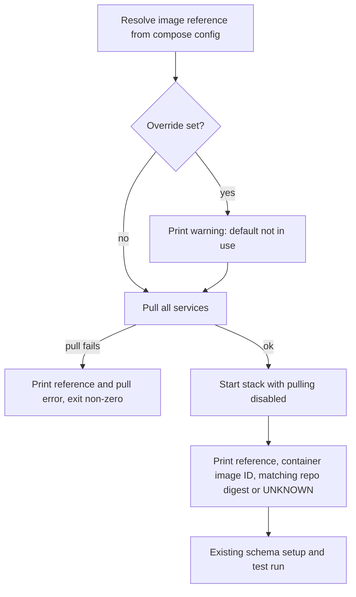
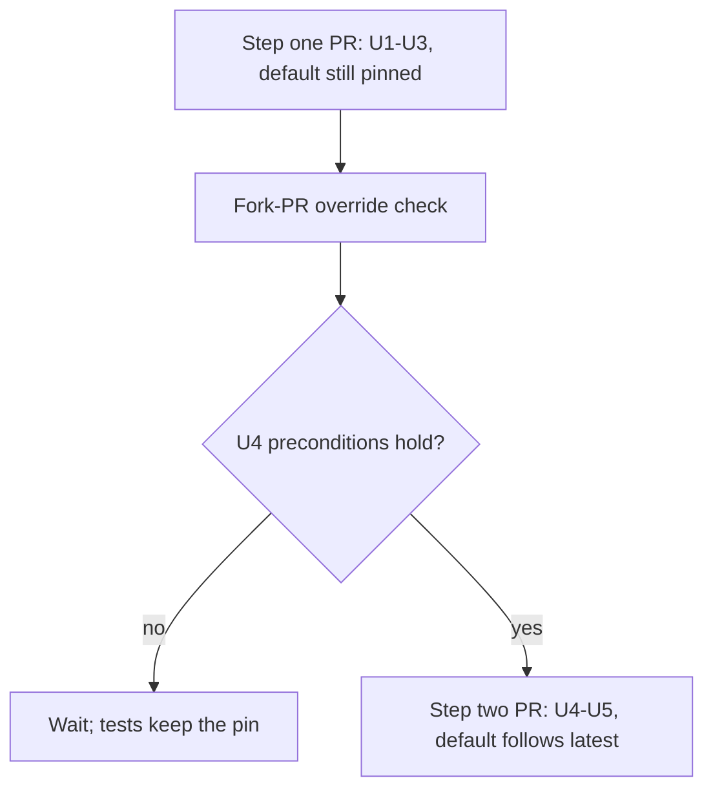

# Registry Test Image Follows GHCR Tag - Plan

## Goal Capsule

- **Objective:** When CILogon's image build produces a new COmanage Registry image, the hermetic and live-server test tiers run against it on their next run, with no copy, pin bump, or pull request from anyone.
- **Means:** CILogon's build also publishes each such image to `ghcr.io/cilogon/comanage-registry` under one fixed tag; both tiers follow that tag and report the exact image each run used (KTD1, KTD2).
- **Authority:** The Product Contract owns behavior (R-IDs win on what happens); the Planning Contract owns mechanism (KTDs win on how); units override neither. The change to CILogon's image build lives outside this repository and is a dependency, not an implementation unit here.
- **Execution profile:** Two pull requests. Step one (U1-U3) lands now and changes no image. Step two (U4-U5) lands only after the U4 preconditions hold.
- **Stop conditions:** Stop before U4 if any U4 precondition fails, or if the build owners have not agreed the tag name (KTD2).
- **Who finishes:** Claude implements, pushes feature branches to the `bot` remote, and opens the PRs on `cilogon/Oa4mpClient`. The developer merges. The build owners make the CILogon build change.
- **Open blockers:** None for planning. U4 waits on the first automated push of the followed tag and on the tag-name agreement.

---

## Product Contract

### Summary

CILogon's Registry image build gains a one-time step that publishes each build destined for ECR `latest` to GHCR under a fixed, public tag. Both test tiers pull that tag instead of a digest pin, print the digest they resolved, and go red when a new image breaks them. The fix for a bad image is to push a fixed one; the existing image override remains a manual escape.

### Problem Frame

Today both tiers run a digest-pinned image taken from `Test/docker/docker-compose.yml`. Picking up a new CILogon build takes two manual steps: someone with package write access copies the image from `public.ecr.aws/cilogon/comanage-registry` to GHCR as `oa4mp-test-<short-digest>`, and then someone opens a pull request bumping the pin (`Test/README.md` "Bumping the Registry image"). Until both happen, the tests run against an image that no longer matches what CILogon ships. The pinned image today is `cilogon-14eb6dba`, built 2026-08-10.

GHCR was adopted only because anonymous ECR Public pulls from Actions runners failed with `toomanyrequests: Data limit exceeded`, and the gate cannot log in to ECR because it uses no secrets (`docs/solutions/integration-issues/oa4mp-ecr-public-anonymous-pull-data-limit-2026-09-28.md`). The GHCR package also holds about 280 other tags. Its versioned release tags (newest `4.3.3-*-26`, June 2024, PHP 8.1) are stock COmanage builds, not CILogon's build, so following "newest release" on GHCR is not an option.

### Key Decisions

- **Both tiers follow the tag, not only the live tier.** Governs R4, R5. (session-settled: user-directed -- chosen over changing only the live tier: the goal is that a colleague's push is all it takes, everywhere the image is used.)
- **CILogon's build publishes to GHCR itself.** Governs R1, R2. (session-settled: user-directed -- chosen over a scheduled mirror job in this repo copying ECR to GHCR, and over keeping per-image `oa4mp-test-*` copies: no new write credential in this repo's CI, and no per-image human step.)
- **Follow the build that becomes ECR `latest`.** Governs R1. (session-settled: user-approved -- chosen over every `develop-*` build and over builds explicitly marked test-ready: tests track what CILogon actually ships.)
- **A bad image turns the tests red; no automatic fallback.** Governs R6, R7. (session-settled: user-approved -- chosen over a repo-side hold mechanism and over keeping the hermetic gate pinned: fix forward by pushing a fixed image, with the existing override as the escape.)
- **The live tier accepts the trust shift.** Governs R10. (session-settled: user-directed -- chosen over provenance verification of the image and over keeping the live tier pinned: package writers are trusted colleagues and the credential is a dev-only test admin client.)
- **Fork pull requests always test the compose default.** Governs R5. (session-settled: user-directed -- chosen over rethinking the escape hatch before step one merged: GitHub passes no repository variables to fork `pull_request` runs, verified on cilogon/Oa4mpClient#41, and the only workaround runs fork code with base-repo context.)
- **Follow a moving tag rather than automate pin-bump pull requests.** Governs R4. (session-settled: user-approved -- chosen over a bot that opens pin-bump PRs: those still need a human merge, which defeats the goal.)
- **PR results are no longer attributable to PR code alone.** Accepted consequence of the decisions above: a colleague's push can turn every open PR red at once, and R6's printed digest is how a reader tells image drift from a code regression. This supersedes R7 and KTD4 of `docs/plans/2026-08-19-0342-test-plugin-test-suite-plan.md` for the Registry image.

### Actors

- A1. CILogon colleague with package write access, who runs or maintains CILogon's Registry image build.
- A2. CILogon's image build pipeline (outside this repo).
- A3. The hermetic tier: the pull-request merge gate, no secrets, runs on fork PRs.
- A4. The live-server tier: scheduled and on-demand on `main`, holds the `dev.cilogon.org` test admin credential.
- A5. A contributor or maintainer reading a red run.

### Requirements

**Publishing contract (dependency on CILogon's build)**

- R1. Each CILogon build that becomes `public.ecr.aws/cilogon/comanage-registry:latest` is also published to `ghcr.io/cilogon/comanage-registry` under one fixed, agreed tag.
- R2. The followed tag is anonymously pullable and runnable on `linux/amd64` Actions runners.
- R3. This repo documents that publishing contract (the tag, what it must point to, and that it must stay public) so the build owners and future readers can find it.

**Image selection in the tests**

- R4. The hermetic and live-server tiers both run the Registry image the followed tag points to at the start of the run, with no digest pin in the default. Local runs re-resolve the tag the same way, so a cached copy never stands in for its current target.
- R5. The image override (`OA4MP_TEST_REGISTRY_IMAGE`) keeps working for local runs, and a maintainer can point both CI tiers at a specific image or digest without committing a change, for every run inside `cilogon/Oa4mpClient`.
- R6. Every run of either tier reports, in its log, the image reference it selected (the followed tag or the override), plus the exact digest it ran when the pull succeeds, or the pull error when it fails.
- R7. When the followed tag cannot be pulled, the run fails with a message naming the image reference, rather than falling back to another image.
- R8. The default moves to the followed tag only after the tag exists on GHCR; until then the current pin stays in force.
- R9. The Postgres database image stays digest-pinned.

**Guards and documentation**

- R10. The live tier's stated rationale for digest pinning is replaced with a record of the accepted trust trade-off: anyone with write access to the GHCR package can affect code that runs next to the dev-only test credential.
- R11. Repo checks that today require a digest-pinned GHCR default instead require the default to follow the agreed GHCR tag and still forbid an ECR Public default.
- R12. Every place that states the digest-pin rule or the manual copy-then-bump procedure is updated to the new contract or marked superseded (see Sources).

### Key Flows

- F1. New CILogon build reaches the tests
  - **Trigger:** A1 merges or releases a change that makes A2 produce a new `latest` build.
  - **Steps:** A2 publishes to ECR as today and to GHCR under the followed tag. The next hermetic run (any PR or push to `main`) and the next live run (07:00 UTC daily or on demand) pull the tag, report its digest, and test against it.
  - **Outcome:** No action by anyone beyond A1's normal build. Covers R1, R4, R6.
- F2. New image breaks the tests
  - **Trigger:** A run on a newly published image fails.
  - **Steps:** A5 compares the reported digest with the last green run's digest. If they differ and the PR's code is not the cause, decide whether the image is defective or CILogon changed Registry on purpose. A defective image means A1 publishes a fixed one. An intended change means the fix is a plugin or test change in this repo, validated against the new digest; in the meantime a maintainer points both CI tiers at the last green digest through the R5 override, and developers do the same locally.
  - **Outcome:** The gate recovers on the next run after either fix lands. Covers R5, R6.

### Acceptance Examples

- AE1. **Covers R4, R6.** Given the followed tag points to digest D1, when a hermetic run starts on a PR, then it runs D1 and its log names the tag and D1.
- AE2. **Covers R4, R6.** Given A2 moves the tag from D1 to D2 overnight, when the 07:00 UTC live run starts, then it runs D2 and its log names D2; no file in this repo changed.
- AE3. **Covers R6, F2.** Given a PR was green on D1 and goes red on D2 with no code change, when a maintainer reads the two logs, then the differing digests show the cause is the image.
- AE4. **Covers R5.** Given `OA4MP_TEST_REGISTRY_IMAGE` is set to a specific digest, when either tier runs, then it uses that digest and reports the override reference and that digest.
- AE5. **Covers R6, R7.** Given the followed tag was deleted or made private, when a fork PR's hermetic run starts, then it fails, reports the image reference and the pull error, and does not run any other image.
- AE6. **Covers R8.** Given the followed tag does not yet exist on GHCR, then the default remains the current digest pin.

### Scope Boundaries

- Implementing the change in CILogon's image build. This plan states the contract (R1, R2) only.
- A repo-side hold or last-known-good fallback. The override (R5) is the only escape.
- Considered and not built: a `workflow_dispatch` input for the live tier. The repository variable (KTD5) already covers scheduled and on-demand runs; add the input only if maintainers need a one-off run without changing the variable.
- Considered and not built: validating the override's value. An ECR or malformed reference fails loudly at pull time and R6 names it; revisit if a bad value ever produces a green run.
- Considered and not built: a shared shell helper for the two run scripts (KTD6).
- Provenance verification (signatures or attestations) of the followed image.
- Following `develop-*` builds, release candidates, or other flavors.
- Auto-following the Postgres image.
- Pruning or reorganizing the other tags in the GHCR package, including the existing `oa4mp-test-e41c82a`.
- Changing which credentials the live tier holds or how it is triggered.

### Dependencies / Assumptions

- CILogon's build owners agree to and implement R1 and R2. Who makes that change, and in which repository, is outside this repo.
- The GHCR package stays public, and anonymous GHCR pulls from Actions runners stay within rate limits. That held after the move off ECR Public.
- The build that becomes ECR `latest` is a single flavor (today's pinned image carries `mod_auth_openidc` labels) and is what the tests were originally built against.

### Outstanding Questions

**Resolved in planning**

- Tag name: `latest` on GHCR, pending the build owners' agreement before U4 (KTD2).
- Where R6 is reported: in both run scripts, so local runs report too (KTD4, KTD6).
- How the R5 CI override is set: a repository-level variable passed into both workflows (KTD5). It does not reach fork PRs (verified on cilogon/Oa4mpClient#41).
- R11's check also locks the reporting and override wiring, asserted on the run scripts and workflows (KTD7).

**Open for the build owners (not blocking U1-U3)**

- Whether they agree to `latest` as the GHCR tag, and whether their build ever prunes untagged GHCR versions (the R5 rollback relies on old digests staying pullable).

### Sources / Research

- `Test/docker/docker-compose.yml:13-16` (Postgres pin), `:28-36` (Registry default and override).
- `Test/run.sh:26` and `Test/run-live.sh:45`: both tiers take the image only from the compose default. No script reports the resolved digest today.
- `Test/Case/CiWorkflowTest.php:178-190` (`testRegistryImageIsPulledFromGhcrByDigest`); `:44` (`testHermeticGateUsesNoSecrets`); `:72-87` (`testLiveTierIsOffThePullRequestPath`).
- `.github/workflows/live-server-tests.yml:83-85` (digest-pin rationale tied to the live credential).
- `Test/README.md:12-14` (stale ECR image line), `:283-287` (pin statement), `:289-313` ("Bumping the Registry image").
- `docs/solutions/integration-issues/oa4mp-ecr-public-anonymous-pull-data-limit-2026-09-28.md`: lines 30, 64-74, 91, 105-107 describe the pin and the two-step bump.
- `docs/plans/2026-08-19-0342-test-plugin-test-suite-plan.md`: R7 (line 56), KTD4 (line 118), assumption (line 94), U7/U9 (lines 225, 252).
- `bin/qdl-conformance.php:690` ("inside a digest-pinned image on purpose"), `Test/Case/Lib/QdlConformanceTest.php:21`, `.github/workflows/hermetic-tests.yml:3`, and the `Test/Case/CiWorkflowTest.php:169-177` docblock also state the pin rule.
- GHCR package inspection (anonymous registry API, 2026-10-16): 283 tags; no `latest`; `oa4mp-test-e41c82a` wraps `sha256:e41c82a9...` labeled `comanage_registry_version: cilogon-14eb6dba`, PHP 8.4.24; `4.3.3-*-26` tags are stock `4.3.3`, PHP 8.1.27, built 2024-06-02.

**Product Contract preservation:** Product Contract unchanged by planning; Outstanding Questions resolved in place.

---

## Planning Contract

### Key Technical Decisions

- KTD1. **Deliver in two steps.** Step one (U1-U3) adds always-pull, run reporting, the CI override, and the publishing contract while the default stays the current pin. Step two (U4-U5) switches the default and rewrites the GHCR-digest check in the same PR, because `testRegistryImageIsPulledFromGhcrByDigest` fails the moment the default stops being a digest. Implements R8.
- KTD2. **The followed tag is `latest` on GHCR.** It mirrors `public.ecr.aws/cilogon/comanage-registry:latest`, so the build pushes the same tag to both registries. The GHCR package has no `latest` today, so nothing collides. Needs the build owners' agreement before U4. Chosen over a repo-specific tag such as `oa4mp-test-current` so colleagues learn no new name. Implements R1.
- KTD3. **Pull explicitly, then start without pulling.** Each run script pulls every compose service, then starts the stack with pulling disabled, so the image that runs is the one just pulled and a tag move between the two steps cannot change it. Chosen over `pull_policy: always`, which pulls again inside `up`. Implements R4 and R7.
- KTD4. **Report from the container that ran.** After start, each script prints the selected reference (resolved compose config, override included), the running container's image ID, and the repo digest entry matching that reference's repository, or `UNKNOWN` when there is none. A failed pull prints the reference and the pull output, then exits non-zero. When the override is set, a warning line says the default is not in use. Implements R6 and R7.
- KTD5. **The CI override is one repository-level variable.** Both workflows pass `vars.OA4MP_TEST_REGISTRY_IMAGE` into the run step's `env:`. It is never defined on the `live-server` environment, where it would shadow the repository value. An unset variable resolves empty, and the compose `:-` default treats empty as unset. Chosen over `workflow_dispatch` inputs: one switch covers PR, push, schedule, and dispatch runs. Implements R5.
- KTD6. **Mirror the logic in both run scripts.** It follows the existing "(Mirrors Test/run.sh.)" convention rather than adding the first shared shell library under `Test/`. (session-settled: user-approved -- chosen over a sourced helper: matches how the scripts already duplicate setup.)
- KTD7. **Lock wiring with repo-text checks.** New `CiWorkflowTest` cases assert the override wiring in both workflows and the pull and report steps in both scripts, on non-comment text. The U4 rewrite keeps the no-ECR assertion and adds a Postgres digest-pin assertion (R9). Implements R11.

### High-Level Technical Design

Each run, in both scripts (KTD3, KTD4):

Rollout (KTD1):

### Assumptions

- Untagged GHCR versions persist until someone deletes them; GitHub documents no automatic cleanup.
- CILogon's build may publish a manifest list, in which case the GHCR digest differs from ECR's. KTD4 reports the image ID alongside the repo digest so runs stay comparable with each other.

### Risks

- The hermetic gate goes red for every PR when a bad image ships. Accepted (Product Contract Key Decisions); R6 output plus the README runbook (U3) are the mitigation.
- An override left set freezes both tiers on an old image while staying green. KTD4's warning line makes that visible in every run log.

---

## Implementation Units

### U1. Always pull and report the image in both run scripts

- **Goal:** Every run re-resolves the Registry image and logs exactly what ran, or fails naming what it could not pull.
- **Requirements:** R4, R6, R7; F2; AE1-AE5. KTD3, KTD4, KTD6.
- **Dependencies:** None.
- **Files:** `Test/run.sh`, `Test/run-live.sh`, `Test/Case/CiWorkflowTest.php`.
- **Approach:**
  1. Before the existing `docker compose up -d`, resolve the Registry reference from compose config and print the override warning when `OA4MP_TEST_REGISTRY_IMAGE` is non-empty.
  2. Pull all services with the scripts' `|| status=$?` capture; on failure print `==> ERROR:` with the reference and pull output to stderr and exit 1.
  3. Start with pulling disabled.
  4. Print the reference, the running Registry container's image ID, and the repo digest matching the reference's repository, or `UNKNOWN`.
  5. Mirror the same block in `Test/run-live.sh`, with its existing "(Mirrors Test/run.sh.)" comment style.
- **Patterns to follow:** `==>` progress and error lines and `|| status=$?` capture in `Test/run.sh`; run-script text assertions in `Test/Case/Controller/ClaimsControllerHarnessTest.php` (the `testRunShRequiresAPlausibleTestCount` neighborhood).
- **Test scenarios:**
  - Covers AE1. Both scripts, on non-comment text, pull before start and start with pulling disabled.
  - Both scripts print the selected reference, the container image ID, and a repo-digest line with an `UNKNOWN` fallback.
  - Covers AE5. Both scripts capture the pull's exit status and exit non-zero with an error naming the reference, rather than relying on `set -e`.
  - Both scripts print a warning when the override is set.
  - Mutation check: remove the pull from one script and confirm the new test goes red, then restore it.
- **Verification:** A local `Test/run.sh` prints the reference, image ID, and digest of the pinned image and the suite passes; running it with the override set to an unpullable reference fails at the pull step naming that reference.

### U2. Pass the CI override from a repository variable

- **Goal:** A maintainer can point both CI tiers at a specific image without a commit.
- **Requirements:** R5; F2; AE4. KTD5, KTD7.
- **Dependencies:** U1 (the warning and report show the override took effect).
- **Files:** `.github/workflows/hermetic-tests.yml`, `.github/workflows/live-server-tests.yml`, `Test/Case/CiWorkflowTest.php`, `Test/run.sh` (count-gate floor).
- **Approach:**
  1. Add `OA4MP_TEST_REGISTRY_IMAGE: ${{ vars.OA4MP_TEST_REGISTRY_IMAGE }}` to the run step `env:` in both workflows. In the hermetic workflow, no key, value, or comment-free text may contain the word that `testHermeticGateUsesNoSecrets` forbids.
  2. Add a `CiWorkflowTest` case modeled on `testLiveTierTakesTheCoIdAsAVariable`: both workflows take the image from `vars.`, never `secrets.`.
  3. Raise `min_tests_run` in `Test/run.sh` for the tests U1 and U2 add, with a "Raised from X to Y" comment paragraph per convention.
- **Patterns to follow:** `testLiveTierTakesTheCoIdAsAVariable` and `testHermeticGateUsesNoSecrets` in `Test/Case/CiWorkflowTest.php`; existing `vars.OA4MP_LIVE_CO_ID` wiring in `.github/workflows/live-server-tests.yml`.
- **Test scenarios:**
  - Covers AE4. Both workflows pass `vars.OA4MP_TEST_REGISTRY_IMAGE` into the run step's environment.
  - Neither workflow sources the image override from `secrets.`.
  - `testHermeticGateUsesNoSecrets` and `testNoOtherWorkflowMixesPullRequestCodeWithSecrets` still pass unchanged.
  - Mutation check: change one workflow to `secrets.OA4MP_TEST_REGISTRY_IMAGE` and confirm the new test goes red.
- **Verification:** With the variable unset, a CI run logs the pinned default with no warning; the fork-PR check in the Verification Contract passes.

### U3. Document the publishing contract and the bad-image runbook

- **Goal:** Build owners and maintainers can find what the build must publish and what to do when a new image turns the tests red.
- **Requirements:** R3; F1, F2. KTD2, KTD5.
- **Dependencies:** U1, U2.
- **Files:** `Test/README.md`.
- **Approach:**
  1. Add a "Registry image publishing contract" section: the build that becomes ECR `latest` is also pushed to `ghcr.io/cilogon/comanage-registry:latest`, public, `linux/amd64`-runnable, with old versions not pruned.
  2. Add a "When a new image breaks the tests" runbook following F2: compare reported digests, decide image defect versus intended change, set or clear the repository variable, and unset it once fixed.
  3. Note in "Bumping the Registry image" that the procedure is the interim path until U4 lands.
- **Test expectation:** none -- documentation only.
- **Verification:** A reader can carry out F2 from the README alone.

### U4. Switch the default to the followed tag

- **Goal:** Both tiers follow `ghcr.io/cilogon/comanage-registry:latest` with no digest pin.
- **Requirements:** R4, R8, R9, R10, R11; F1; AE2, AE6. KTD1, KTD2, KTD7.
- **Dependencies:** U1, U2, U3 merged, and every precondition below.
- **Preconditions (stop if any fails):**
  1. The build owners agreed the tag name.
  2. `ghcr.io/cilogon/comanage-registry:latest` exists and pulls anonymously after `docker logout ghcr.io`.
  3. It runs on `linux/amd64`.
  4. The hermetic suite passes locally with the override set to that tag.
  5. The repository variable is unset.
- **Files:** `Test/docker/docker-compose.yml`, `Test/Case/CiWorkflowTest.php`, `.github/workflows/live-server-tests.yml`.
- **Approach:**
  1. Change the Registry default to the tag; leave the Postgres pin.
  2. Replace `testRegistryImageIsPulledFromGhcrByDigest` with a test that requires the default to be the GHCR tag and still forbids `public.ecr.aws`; add a Postgres digest-pin assertion.
  3. Replace the live workflow's digest-pin rationale comment with the R10 trust record.
  4. Update the compose comments to the new contract.
- **Patterns to follow:** the existing regex assertion and its docblock style in `Test/Case/CiWorkflowTest.php`.
- **Test scenarios:**
  - Covers AE2. The compose Registry default is `${OA4MP_TEST_REGISTRY_IMAGE:-ghcr.io/cilogon/comanage-registry:latest}`.
  - No compose default comes from `public.ecr.aws`.
  - The Postgres default is still digest-pinned.
  - Mutation checks: restore the old digest default, then set an ECR default, and confirm the new test goes red each time.
- **Verification:** The hermetic suite passes on the tag and its log shows the tag, image ID, and digest; after merge, a dispatched live run shows the same.

### U5. Sweep the pin rule out of the docs

- **Goal:** No doc or comment still tells readers the tests are digest-pinned or that a pin must be bumped.
- **Requirements:** R12. KTD1.
- **Dependencies:** U4 (same PR).
- **Files:** `Test/README.md`, `.github/workflows/hermetic-tests.yml`, `bin/qdl-conformance.php`, `Test/Case/Lib/QdlConformanceTest.php`, `Test/Case/CiWorkflowTest.php` (docblock), `docs/solutions/integration-issues/oa4mp-ecr-public-anonymous-pull-data-limit-2026-09-28.md`, `docs/plans/2026-08-19-0342-test-plugin-test-suite-plan.md`.
- **Approach:**
  1. Rewrite the stale image line and pin statements in `Test/README.md`; retire "Bumping the Registry image" in favor of the U3 sections.
  2. Fix the comment wording in the hermetic workflow header, `bin/qdl-conformance.php`, `QdlConformanceTest.php`, and the `CiWorkflowTest` docblock, and update every citation of the renamed test.
  3. Mark the solution doc's two-step bump and the test-suite plan's R7 and KTD4 as superseded for the Registry image, citing this plan; do not delete them.
- **Test expectation:** none -- comment and documentation changes; U4's tests cover behavior.
- **Verification:** A search for the old test name, "digest-pinned", and "bump" in those files finds only superseded notes.

---

## Verification Contract

| Check | Applies to | Done signal |
|---|---|---|
| `Test/run.sh` (the only supported way to run PHP tests) | U1, U2, U4 | Suite passes, count gate holds, log shows reference, image ID, and digest |
| Mutation checks named in each unit's test scenarios | U1, U2, U4 | Each new test goes red on the named mutation, then green when restored; recorded in the commit message per the README compound norm |
| Fork-PR override check | U2 | Done 2026-10-16 on cilogon/Oa4mpClient#41: with the repository variable set to the pinned digest, the fork PR's run received it empty and printed no warning. Fork PRs always use the default (Key Decisions) |
| U4 preconditions | U4 | All five hold before the step-two PR is opened |
| Dispatched live run on `main` after step two merges | U4 | Log shows the tag, image ID, and digest; run result matches the hermetic tier |

---

## Definition of Done

- Step one: U1-U3 merged upstream; CI green on that PR; fork-PR override result recorded.
- Step two: U4-U5 merged upstream after the preconditions held; a dispatched live run on the tag reported its image.
- Every new test was mutation-checked and the count-gate floor raised with its comment paragraph.
- No experimental or abandoned code from either step remains in the diff.
